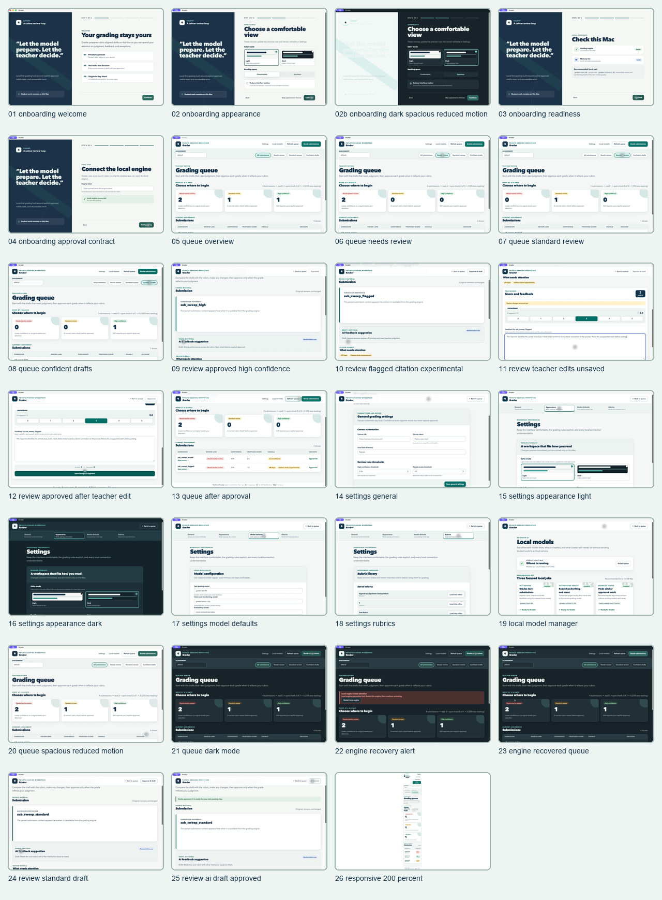

# Grader v0.1.1 simulated grading session

This folder contains a complete demo walk-through of the signed Grader macOS app using only
synthetic submissions. No real student work was displayed, no live Canvas write was performed,
and the citation warning shown here is intentionally labeled experimental.

The native screenshots were captured from `/Applications/Grader.app` with Computer Use. The
fresh-profile onboarding run was reversible: the existing WebKit profile was moved aside and
restored after capture. `26-responsive-200-percent.png` comes from the project's deterministic
Playwright visual sweep because it needs a precisely controlled 200% text viewport.

## At a glance

## Onboarding

| Screenshot | State |
| --- | --- |
| [01-onboarding-welcome.png](01-onboarding-welcome.png) | Privacy-first welcome and teacher-decision contract |
| [02-onboarding-appearance.png](02-onboarding-appearance.png) | Light-mode appearance choices |
| [02b-onboarding-dark-spacious-reduced-motion.png](02b-onboarding-dark-spacious-reduced-motion.png) | Dark, spacious, reduced-motion preview |
| [03-onboarding-readiness.png](03-onboarding-readiness.png) | Local engine and model readiness |
| [04-onboarding-approval-contract.png](04-onboarding-approval-contract.png) | Per-launch engine token and final start step |

## Queue and review lanes

| Screenshot | State |
| --- | --- |
| [05-queue-overview.png](05-queue-overview.png) | All synthetic submissions |
| [06-queue-needs-review.png](06-queue-needs-review.png) | Needs-teacher-review lane |
| [07-queue-standard-review.png](07-queue-standard-review.png) | Standard-review lane |
| [08-queue-confident-drafts.png](08-queue-confident-drafts.png) | High-confidence drafts lane |
| [13-queue-after-approval.png](13-queue-after-approval.png) | Queue after the teacher approves a flagged draft |
| [20-queue-spacious-reduced-motion.png](20-queue-spacious-reduced-motion.png) | Spacious density with reduced motion |
| [21-queue-dark-mode.png](21-queue-dark-mode.png) | Queue in dark mode |

## Simulated teacher review

| Screenshot | State |
| --- | --- |
| [09-review-approved-high-confidence.png](09-review-approved-high-confidence.png) | Previously approved high-confidence work |
| [10-review-flagged-citation-experimental.png](10-review-flagged-citation-experimental.png) | Low-confidence, off-topic, experimental citation signal |
| [11-review-teacher-edits-unsaved.png](11-review-teacher-edits-unsaved.png) | Teacher changes score and feedback; unsaved state remains explicit |
| [12-review-approved-after-teacher-edit.png](12-review-approved-after-teacher-edit.png) | Teacher-edited grade after explicit approval |
| [24-review-standard-draft.png](24-review-standard-draft.png) | Unedited standard-review draft |
| [25-review-ai-draft-approved.png](25-review-ai-draft-approved.png) | AI draft after direct teacher approval |

## Settings and models

| Screenshot | State |
| --- | --- |
| [14-settings-general.png](14-settings-general.png) | Canvas/local storage and review thresholds |
| [15-settings-appearance-light.png](15-settings-appearance-light.png) | Appearance settings in light mode |
| [16-settings-appearance-dark.png](16-settings-appearance-dark.png) | Appearance settings in dark mode |
| [17-settings-model-defaults.png](17-settings-model-defaults.png) | Text, vision, and embedding model defaults |
| [18-settings-rubrics.png](18-settings-rubrics.png) | Saved rubric library and rubric editor |
| [19-local-model-manager.png](19-local-model-manager.png) | On-device model status and storage inventory |

## Recovery and accessibility

| Screenshot | State |
| --- | --- |
| [22-engine-recovery-alert.png](22-engine-recovery-alert.png) | Local engine stopped; visible recovery alert |
| [23-engine-recovered-queue.png](23-engine-recovered-queue.png) | Queue restored after using the recovery action |
| [26-responsive-200-percent.png](26-responsive-200-percent.png) | Full-page 200% text reflow at a 720-pixel viewport |

## Synthetic session data

The session used four local-only records covering needs-review, standard-review, and
high-confidence lanes. The demo teacher raised one flagged score from 1 to 3, added specific
revision feedback, approved it, and separately approved a standard draft. These actions affected
only the synthetic local grading database.
