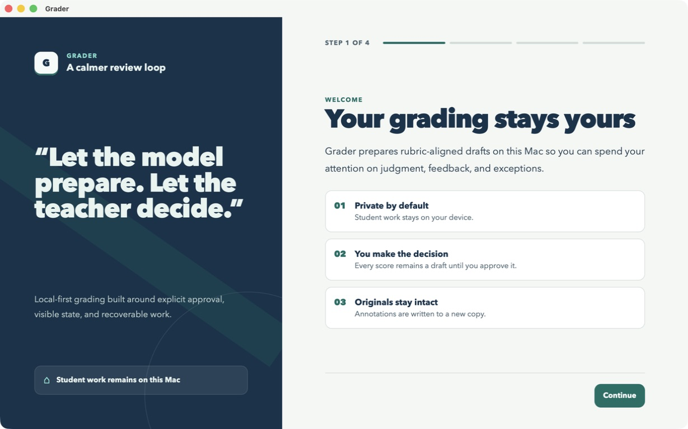
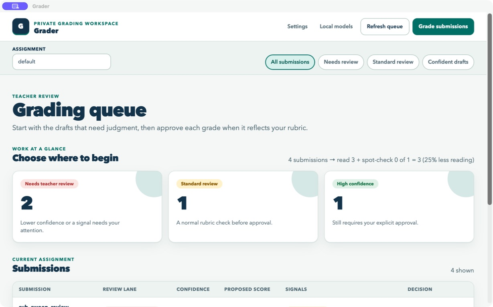
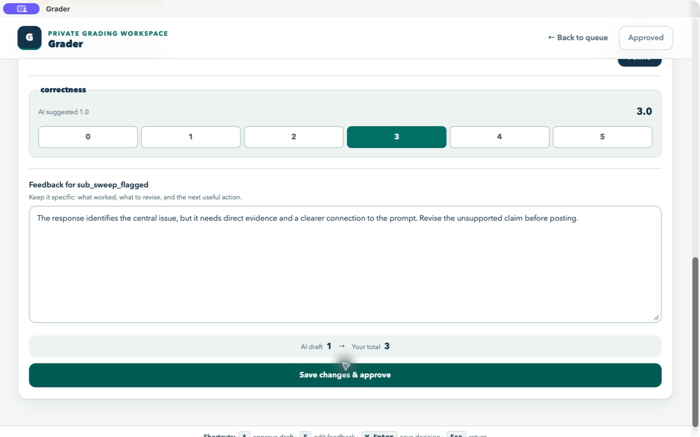

# Grader Instructor Guide

This guide explains how to use Grader v0.1.1 during the supervised public beta. Grader prepares
local rubric-aligned drafts; the instructor remains responsible for every score, comment, and
Canvas posting decision.

> **Beta boundary:** citation checks are experimental. Canvas import and post-back are implemented
> in the local engine but do not yet have dedicated buttons in the desktop interface. A supervised
> beta facilitator must perform those two steps. Grading and approval happen in the app.

## Quick start

1. Install the signed Grader app by following [Installation](INSTALL.md).
2. Start Ollama and confirm the three recommended local model tags are ready.
3. Launch Grader and complete the four onboarding screens.
4. Open **Settings** to configure Canvas, review thresholds, model defaults, and a rubric.
5. Import an assignment with your beta facilitator, or use synthetic/local test data.
6. Enter the assignment key in the queue and choose **Grade submissions**.
7. Review the **Needs review** lane first, then **Standard review**, then spot-check confident drafts.
8. Approve an unchanged draft or edit its score/feedback and choose **Save changes and approve**.
9. Have the beta facilitator post approved grades to Canvas and read back at least one score and
   comment before posting a larger batch.

Nothing posts to Canvas merely because a draft was generated or approved.

## 1. Install and prepare this Mac

Minimum practical requirements:

- macOS 13 or later
- 16 GB RAM
- about 20 GB free storage for the app, models, and working files
- Ollama running locally
- the signed and notarized Grader release from the
  [public release channel](https://github.com/johnnyrobot/grader-releases/releases/latest)

Open **Local models** from the queue. Grader expects:

| Model | Job |
| --- | --- |
| `grader-text:8b` | Grades extracted text and drafts feedback |
| `grader-vision:1.3b` | Transcribes scans and handwriting; it never grades directly |
| `nomic-embed-text:latest` | Finds similar teacher-approved examples |

If all three say **Ready for Grader**, continue. If Ollama is not detected, start Ollama and choose
**Refresh status**. If Grader downloads a base text or vision model but the capped Grader tag still
shows **Needed**, the beta facilitator must run `scripts/make_models.sh`; do not substitute an
uncapped raw model tag for grading.

## 2. Complete first-run onboarding



The signed app normally discovers its per-launch engine token automatically.

1. **Welcome:** confirm the local-first and teacher-approval boundaries.
2. **Appearance:** choose light mode, comfortable or spacious density, and reduced motion if useful.
3. **Check this Mac:** wait until the local grading engine reports **Ready**.
4. **Connect the local engine:** leave the token field blank in the signed app. Enter a token only
   when a developer has deliberately started the engine by hand and supplied that token.
5. Choose **Start grading**.

Appearance choices can be changed later without repeating onboarding.

## 3. Configure Settings

Choose **Settings** from the queue.

### General

- **Canvas URL:** use your institution's full Canvas base URL, such as
  `https://canvas.example.edu`.
- **Canvas token:** paste a new token only when configuring or rotating credentials. Grader stores
  it locally and masks the saved value.
- **Local data directory:** use an institution-approved local location. Do not put student work in
  a cloud-synchronized folder unless your institution explicitly authorizes it.
- **High-confidence threshold:** controls which drafts enter the confident lane. It never enables
  automatic approval.
- **Needs-review threshold:** drafts below this confidence enter the first-review lane.

Choose **Save general settings** after changing these fields. Never include a Canvas token in a
screenshot, issue, email, or repository file.

### Appearance

Choose light or dark mode, comfortable or spacious density, and reduced motion. These settings are
local to this Mac and apply immediately.

### Model defaults

Keep the capped defaults unless the beta facilitator has validated a replacement:

- text: `grader-text:8b`
- vision: `grader-vision:1.3b`
- embeddings: `nomic-embed-text:latest`

### Rubrics

1. Open the **Rubrics** tab.
2. Enter a clear rubric title.
3. Paste criteria from Canvas, a table, or JSON into **Rubric text**.
4. Choose **Save rubric**.
5. Use **Load into editor** to inspect or amend a saved version.

Review criterion names, point ranges, and descriptions before grading. See
[Rubric authoring](RUBRIC_AUTHORING.md) for recommended formats and versioning behavior.

## 4. Import an assignment

### Current v0.1.1 interface boundary

The desktop queue does not yet expose **Import from Canvas** or **Post to Canvas** buttons. During
the supervised beta, an authorized facilitator performs import and post-back through Grader's
authenticated local engine while the instructor performs grading and approval in the app.

For a Canvas import, the facilitator should:

1. Confirm the exact Canvas course ID and assignment ID with the instructor.
2. Use the local authenticated `/api/canvas/import` route.
3. Review any per-student download or parsing failures.
4. Tell the instructor the assignment key:
   `canvas_<course_id>_<assignment_id>`.
5. Keep downloaded submissions on the instructor's approved local storage only.

The guarded `scripts/live_canvas_e2e.py` command is for a course visibly marked
`ZZ-GRADER-TEST`; never point that sandbox harness at a real course.

For local or synthetic work, the imported records use the assignment ID supplied during import.
The empty queue intentionally says **Import submissions, then choose Grade submissions**.

## 5. Prepare local grading drafts



1. Enter the imported assignment key in **Assignment**.
2. Choose **Refresh queue** and confirm the expected submission count.
3. Choose **Grade submissions**.
4. Keep Grader open while the local model works. The queue updates as jobs progress.
5. If the count, assignment, or student references are wrong, stop and resolve the import before
   reviewing or approving anything.

Drafts are organized into three lanes:

| Lane | Meaning | Recommended action |
| --- | --- | --- |
| **Needs teacher review** | Lower confidence or a review signal | Read first and inspect every criterion |
| **Standard review** | Normal rubric check | Compare the draft with the work and rubric |
| **High confidence** | Stronger local-model confidence | Spot-check carefully; explicit approval is still required |

Signals such as **Off Topic**, **Low Confidence**, or **Citation check (experimental)** are prompts
for teacher attention, not findings that should automatically change a student's score.

## 6. Review and approve a submission



Open a submission from the queue and work from left to right:

1. Compare the source material with the rubric.
2. Read the AI feedback as a draft, not a final comment.
3. Inspect every review signal.
4. Select the appropriate score for each criterion.
5. Rewrite the feedback so it says what worked, what should change, and the next useful action.
6. Confirm the displayed total.
7. Choose one approval path:
   - **Approve AI draft** when no score or feedback was changed.
   - **Save changes and approve** after a teacher edit.
8. Wait for a success message. If Grader says the decision was not saved, the edits remain visible;
   retry after recovering the local engine.

An unsaved teacher edit is labeled **Teacher changes not saved yet**. Do not leave the screen until
the success message appears or you have intentionally decided to keep the item as a draft.

Keyboard shortcuts:

| Shortcut | Action |
| --- | --- |
| `A` | Approve an unchanged draft |
| `E` | Focus the feedback editor |
| `Command` + `Enter` | Save the current decision |
| `Esc` | Return to the queue |

## 7. Post approved grades to Canvas

Posting is a separate supervised action. Approval makes a grade eligible to post; it does not send
anything by itself.

The beta facilitator should:

1. Confirm that every requested grade ID is teacher-approved.
2. Use the authenticated local `/api/canvas/post` route with the exact course and assignment IDs.
3. Wait until Canvas reports its asynchronous Progress object as `completed`.
4. Read back at least one posted score and teacher comment from Canvas.
5. Report skipped or failed students instead of claiming the whole batch succeeded.

Current beta post-back includes the total score and teacher feedback comment. Canvas rubric
assessment posting remains disabled until local criteria map to real Canvas criterion IDs, and
annotated attachment post-back requires separate validation. Verify the result in Canvas before
students rely on it.

## 8. Updates and recovery

When Grader shows an update banner:

1. Finish or save the current review.
2. Choose **Install update and restart**.
3. Let the signed updater relaunch the app.
4. Confirm the queue and local models still load.

If the queue shows **Local engine needs attention**, choose **Restart local engine**. The queue and
current local records should remain available. If recovery fails, quit and reopen Grader; do not
re-import or re-post until the beta facilitator checks the local database and audit trail.

## 9. Privacy and safe beta use

- Use real student work only with institutional authorization.
- Keep Grader data and models on the instructor's Mac.
- Do not commit, email, or upload student submissions, databases, tokens, or screenshots containing
  identifiable student information.
- Citation verification may contact DOI and scholarly metadata services using the citation
  reference, never the full submission. Treat its v0.1.1 result as experimental.
- Never infer approval from a confidence label. Approval must be explicit and visible.
- Start with a small assignment and verify one Canvas read-back before expanding the batch.

See [FERPA and privacy](FERPA.md) for the network allowlist and data-handling rules.

## 10. Practice safely with synthetic data

Developers and supervised facilitators can run:

```bash
uv run python scripts/dev_mock_engine.py
```

This provides synthetic queue, settings, rubric, and model responses for UI practice. It is not
release evidence and must not be mistaken for a live Canvas round trip.

## Troubleshooting

| Problem | What to do |
| --- | --- |
| Grader waits for the engine | Keep the app open briefly, then use **Restart local engine** or relaunch |
| Ollama is not detected | Start Ollama, open **Local models**, and choose **Refresh status** |
| A capped model is missing | Ask the beta facilitator to run `scripts/make_models.sh` |
| Queue is empty | Confirm import succeeded and the assignment key is exact |
| Grade cannot start | Confirm the Assignment field is not blank and the local engine is connected |
| Approval was not saved | Keep the edits visible, recover the engine, and retry |
| Canvas post is incomplete | Do not report success until Progress is `completed` and read-back matches |
| Citation result seems wrong | Treat it as experimental and decide from the source and rubric yourself |

For installation-specific problems, see [Installation](INSTALL.md). Beta facilitators should also
read the [Beta rollout guide](BETA_ROLLOUT.md) and current [handoff](HANDOFF.md).
